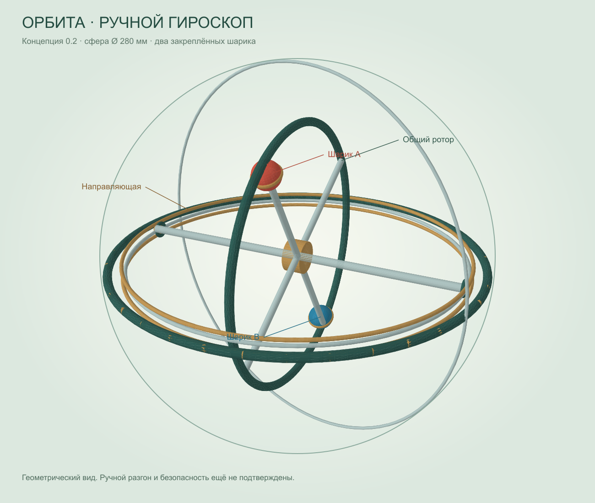

# Орбита — интерактивная 3D-концепция гироскопа

Два закреплённых шарика на общем роторе внутри прозрачной сферы. В этом репозитории опубликована концепция 0.2 от 29 сентября 2026 года: наружный диаметр **280 мм**. Это не уменьшенная версия 55 мм.



## Как открыть

**[Открыть «Орбиту» прямо в браузере](https://stels935-arch.github.io/orbita-gyroscope/)** — установка и скачивание не нужны. Нажмите «Пуск анимации» для вращения ротора.

Для работы без интернета:

1. Нажмите **Code → Download ZIP** на странице репозитория.
2. Распакуйте архив целиком.
3. Откройте `index.html` или `Открыть Гироскоп.html` в браузере с поддержкой WebGL.

Интернет для локального просмотра не нужен: Three.js включён в комплект. Страница репозитория GitHub показывает исходники; ссылка выше запускает интерактивную модель на GitHub Pages.

Мышью или пальцем можно вращать обзор, колесом менять масштаб. Есть виды корпуса, разреза и механизма, запуск/пауза анимации, скорость показа и условные наклоны корпуса. Файл `orbit-gyro.glb` содержит неподвижную 3D-сборку для совместимого редактора; единицы GLB — метры.

## Важные ограничения

Это **кинематическая иллюстрация, а не проверенный физический симулятор или производственная модель**. Движения заданы программой. Разгон от рук, трение, нагрузки, балансировка, крепления и безопасные обороты не рассчитаны. Не используйте эту геометрию для изготовления высокоскоростного изделия. Пригодность для детей не подтверждена.

Подробности и физические источники — в [пояснении к концепции](<Прочитать сначала.md>). Статичная иллюстрация выше получена геометрическим рендерингом, а не снимком браузера.

## Для разработчика

Для просмотра установка не нужна. Для проверок нужен Node.js:

```sh
node verify-publication.cjs
node test-controls.cjs
node export-glb.cjs
```

Для полной проверки геометрии и повторного создания `preview.png`:

```sh
npm install
npm run qa
```

`test-controls.cjs` использует заглушки DOM и рендерера; это не проверка WebGL в настоящем браузере. `qa.cjs` проверяет 6000 положений двух противоположных грузов и габариты модели. Эти проверки не подтверждают работоспособность физического привода.

## Состав и лицензии

- `model.js` — геометрия; `motion.js` — заданная анимация; `app.js` — просмотр и управление.
- `index.html` и русскоязычный HTML-файл — одинаковые точки входа.
- `three.min.js` — Three.js; условия MIT приведены в `THREE-LICENSE.txt` и относятся к этой библиотеке.
- Отдельная лицензия на собственные файлы проекта пока не выбрана.

Репозиторий содержит только «Орбиту», без других игр, личных настроек и документов компании.
